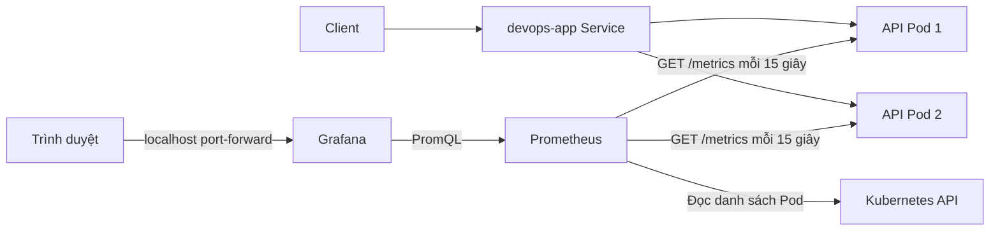

# Pillar 3 Prometheus và Grafana

Bản thiết kế này bổ sung monitoring cho API Node.js với 2 replica trên kind. Prometheus thu thập số liệu riêng của từng Pod; Grafana hiển thị request rate, lỗi, độ trễ và tài nguyên tiến trình Node.js. Cấu hình và dashboard nằm trong Git để có thể dựng lại môi trường demo.

## Kiến trúc



Prometheus và Grafana chạy trong namespace `monitoring`; ứng dụng vẫn ở `devops-app`. Role chỉ cho Prometheus đọc Pod trong namespace ứng dụng. Pod discovery chọn label `app=devops-app`, container `api`, cổng có tên `http`, trạng thái Running. Không lọc readiness để Pod Running nhưng không trả được metrics vẫn xuất hiện với `up=0`.

Scrape qua Service cân bằng tải có thể trả về số đếm của các Pod khác nhau giữa hai lần thu thập. Vì vậy Prometheus lấy trực tiếp địa chỉ từng Pod và gắn label `pod`; dashboard cộng các rate để có số liệu toàn ứng dụng. Cấu hình dựa trên [Kubernetes service discovery của Prometheus](https://prometheus.io/docs/prometheus/latest/configuration/configuration/#kubernetes_sd_config).

## Các metrics và dashboard

| Metric | Ý nghĩa |
| --- | --- |
| `http_requests_total` | Counter request đã hoàn tất, theo method, route, status_code |
| `http_request_duration_seconds` | Histogram thời gian xử lý request, đơn vị giây |
| `process_cpu_seconds_total` | CPU tích lũy của tiến trình; lấy rate để tính số core sử dụng |
| `process_resident_memory_bytes` | Bộ nhớ RSS của tiến trình trên Linux |
| `nodejs_eventloop_lag_p99_seconds` | Độ trễ event loop p99 |
| `up{job="devops-app"}` | Prometheus scrape Pod thành công hay thất bại |

Metrics dùng [Prometheus client cho Node.js](https://github.com/prometheus/client_js), package `@prometheus-io/client` được pin trong lockfile. `/health` và `/metrics` không được tính vào counter/histogram HTTP. Route không tồn tại được gom thành `unmatched`; query string và đường dẫn tùy ý không trở thành labels. Counter đặt lại khi tiến trình khởi động lại; dùng `rate()` trước khi cộng giữa các Pod.

Dashboard có 8 ô: số Pod scrape được, request/giây, request theo HTTP status, tỷ lệ 4xx và 5xx, latency p50/p95, CPU, RSS, event loop lag. CPU/RSS là số liệu của ứng dụng, không phải toàn node hoặc toàn cluster. Latency không có giá trị khi chưa có traffic; khoảng bucket nhỏ nhất là 5 ms nên percentile chỉ là ước lượng với API rất nhanh.

Grafana tự nạp datasource và dashboard bằng [file provisioning](https://grafana.com/docs/grafana/latest/administration/provisioning/). Muốn sửa dashboard bền vững, sửa `k8s/monitoring/grafana/devops-app.json` rồi apply lại Kustomize.

## Chuẩn bị image ứng dụng

Chạy các lệnh từ thư mục gốc repo. Cần Docker đang chạy, `kind`, `kubectl`, Node.js 24 và cluster `devops-two-nodes`. Nếu chưa có cluster:

```sh
kind create cluster --name devops-two-nodes --config kind/two-nodes.yaml --wait 120s
```

Kiểm tra code và build image local mới. Image GHCR cũ trong manifest chưa có `/metrics`:

```sh
npm ci
npm test
npm run lint
docker build -f dockerfile -t devops-app:monitoring .
kind load docker-image devops-app:monitoring --name devops-two-nodes

kubectl --context kind-devops-two-nodes apply -f k8s/app/namespace.yaml
kubectl --context kind-devops-two-nodes apply -f k8s/app/configmap.yaml
kubectl --context kind-devops-two-nodes apply -f k8s/app/service.yaml
kubectl --context kind-devops-two-nodes apply -f k8s/app/deployment.yaml
kubectl --context kind-devops-two-nodes -n devops-app set image deployment/devops-app api=devops-app:monitoring
kubectl --context kind-devops-two-nodes -n devops-app rollout status deployment/devops-app --timeout=180s
```

Lệnh `set image` chỉ thay image đang chạy. Nếu apply lại manifest gốc, cần chạy lại `set image`. Sau khi CI đã publish code mới, cách lâu dài là cập nhật trường `image` trong `k8s/app/deployment.yaml` sang tag SHA đã publish rồi apply. Khi build lại cùng tag local, load lại vào kind và `rollout restart deployment/devops-app`.

## Triển khai monitoring

Tạo mật khẩu ngẫu nhiên ở Secret, không lưu mật khẩu trong Git. Chạy lệnh tạo Secret một lần cho namespace mới; nếu Secret đã có thì giữ lại:

```sh
kubectl --context kind-devops-two-nodes apply -f k8s/monitoring/namespace.yaml
kubectl --context kind-devops-two-nodes -n monitoring create secret generic grafana-admin \
  --from-literal=admin-user=admin \
  --from-literal=admin-password="$(openssl rand -hex 24)"

kubectl --context kind-devops-two-nodes apply -k k8s/monitoring
kubectl --context kind-devops-two-nodes -n monitoring rollout status deployment/prometheus --timeout=180s
kubectl --context kind-devops-two-nodes -n monitoring rollout status deployment/grafana --timeout=180s
```

Dùng `apply -k`, không dùng `apply -f k8s/monitoring`: Kustomize tạo ConfigMap từ các file cấu hình và dashboard JSON. Tên ConfigMap có hash, nên thay cấu hình sẽ tạo rollout mới. Role trong `devops-app` yêu cầu namespace ứng dụng tồn tại trước.

Mở hai terminal và giữ mỗi lệnh chạy:

```sh
kubectl --context kind-devops-two-nodes -n monitoring port-forward service/prometheus 9090:9090
```

```sh
kubectl --context kind-devops-two-nodes -n monitoring port-forward service/grafana 3003:3000
```

Truy cập Prometheus tại `http://localhost:9090`, vào Targets để kiểm tra job `devops-app` có 2 target UP. Grafana ở `http://localhost:3003`, username `admin`. Lấy mật khẩu local:

```sh
kubectl --context kind-devops-two-nodes -n monitoring get secret grafana-admin \
  -o jsonpath='{.data.admin-password}' | base64 --decode
```

Trong Grafana mở folder **DevOps**, dashboard **DevOps API Overview**. Đợi ít nhất 2 lượt scrape; dùng khung thời gian 15–30 phút. Port-forward có thể dừng khi Pod được thay thế; chạy lại khi cần.

## Tạo traffic để kiểm tra

Port-forward ứng dụng ở terminal riêng:

```sh
kubectl --context kind-devops-two-nodes -n devops-app port-forward service/devops-app 3002:80
```

Gọi API trong khoảng 2 phút, gồm request thành công và 404:

```sh
for i in $(seq 1 600); do
  curl -fsS http://localhost:3002/ > /dev/null
  curl -sS http://localhost:3002/missing > /dev/null
  sleep 0.2
done
```

Port-forward Service chọn một Pod, nên traffic local này chủ yếu làm tăng số liệu trên một Pod. Prometheus vẫn scrape cả hai. Muốn thử cân bằng tải thực sự, gửi traffic đến Service từ trong cluster.

Kiểm tra các truy vấn ở Prometheus:

```promql
up{job="devops-app"}
sum(rate(http_requests_total{job="devops-app"}[5m]))
sum by (status_code) (rate(http_requests_total{job="devops-app"}[5m]))
histogram_quantile(0.95, sum by (le) (rate(http_request_duration_seconds_bucket{job="devops-app"}[5m])))
```

404 tăng dòng 4xx; không phải lỗi 5xx. App hiện không có route cố tình gây lỗi 500. Dashboard chỉ có số liệu đo được, không sinh giả dữ liệu lỗi. Chụp Targets, dashboard sau khi có traffic và danh sách Pod để lưu bằng chứng thực hành.

## Alert và giới hạn của bản demo

Hai rule trong `prometheus/alerts.yml` phát hiện target scrape lỗi liên tục 2 phút và không tìm thấy target nào trong 2 phút. Xem trạng thái pending/firing tại trang Alerts của Prometheus. Chưa có Alertmanager nên không gửi email hoặc chat. Các rule này không phát hiện trường hợp chỉ còn 1 trong 2 replica; muốn cảnh báo theo desired replicas cần bổ sung kube-state-metrics.

Prometheus và Grafana dùng `emptyDir`: container restart trong cùng Pod giữ volume, nhưng Pod bị thay thế hoặc xóa sẽ mất dữ liệu. Prometheus giữ tối đa khoảng 3 ngày hoặc 512 MB TSDB; volume 1 GiB dành thêm chỗ cho WAL và head. Đây không phải lưu trữ bền vững; giới hạn bộ nhớ/đĩa cần điều chỉnh theo tải thực tế. Cập nhật cấu hình gây rollout cũng làm mất lịch sử metrics. Datasource/dashboard được khôi phục từ Git; các thay đổi tài khoản và cấu hình UI khác của Grafana không được giữ khi thay Pod.

Khi cần dùng lâu dài, chuyển sang PVC, cấu hình backup và Alertmanager. Node exporter/kube-state-metrics thuộc bước mở rộng để giám sát hạ tầng. Hai Service monitoring là ClusterIP, truy cập local bằng port-forward. `/metrics` dùng chung cổng API, nên tunnel công khai đến API cũng có thể truy cập endpoint này; khi public app lâu dài cần chặn `/metrics` tại ingress/proxy hoặc tách cổng nội bộ.

## Xử lý sự cố

| Hiện tượng | Kiểm tra |
| --- | --- |
| Target trả 404 | Pod còn chạy image cũ; build và triển khai image có `/metrics` |
| Không có target | Namespace, label `app=devops-app`, container `api`, port name `http`, trạng thái Pod và RoleBinding |
| Log discovery báo forbidden | Role ở `devops-app`, ServiceAccount `monitoring/prometheus` |
| Grafana CreateContainerConfigError | Secret `grafana-admin` tồn tại trong `monitoring` và có đủ hai key |
| Dashboard trống | Target UP, có traffic, đủ 2 lượt scrape, khung thời gian phù hợp |
| ImagePullBackOff | Kiểm tra tag image, kết nối registry và quyền pull GHCR |
| Pod OOMKilled | Kiểm tra tải rồi điều chỉnh memory requests/limits |

```sh
kubectl --context kind-devops-two-nodes -n monitoring get pods
kubectl --context kind-devops-two-nodes -n monitoring logs deployment/prometheus --tail=100
kubectl --context kind-devops-two-nodes -n monitoring logs deployment/grafana --tail=100
kubectl --context kind-devops-two-nodes -n devops-app get pods -o wide
```

## Kiểm tra cấu hình trước khi triển khai

```sh
kubectl kustomize k8s/monitoring > /tmp/devops-monitoring.yaml
docker run --rm --entrypoint promtool \
  -v "$PWD/k8s/monitoring/prometheus:/etc/prometheus:ro" \
  prom/prometheus:v3.14.0 check config --syntax-only /etc/prometheus/prometheus.yml
docker run --rm --entrypoint promtool \
  -v "$PWD/k8s/monitoring/prometheus:/etc/prometheus:ro" \
  prom/prometheus:v3.14.0 check rules /etc/prometheus/alerts.yml
```

`--syntax-only` bỏ qua việc tìm ServiceAccount token khi chạy ngoài Kubernetes. Các kiểm tra local không thay cho việc xác nhận Targets UP và dashboard trên cluster thật.
